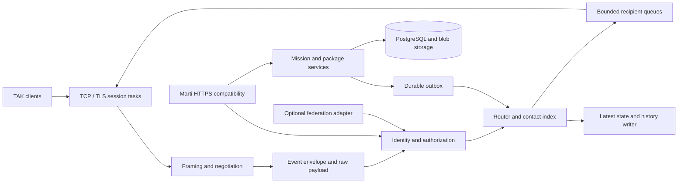

# Proposed Rust server architecture

Everything in this document is a design proposal informed by the preceding research, not implemented functionality. Existing application files were left unchanged.

## Architecture



The messaging data path and HTTP control/content paths share identity and authorization. Blocking file compression, certificate generation, and expensive parsing must not monopolize asynchronous socket workers.

## Module boundaries

| Module / possible crate | Responsibility | Contract |
|---|---|---|
| tak-wire | XML framing, varints, binary framing, negotiation | Bounded stateful decoders; no database |
| tak-proto-client | Generated selected client protobuf schema | Pinned inputs and notices |
| tak-proto-federation | Generated federation types | Separate packages/build outputs |
| tak-cot | Indexed event model, detail preservation, conversions | Explicit loss/error result |
| tak-identity | Certificate/account/device binding | Authenticated principal, policy generation |
| tak-policy | Group, mission, destination authorization | Same checks for routing and reads |
| tak-router | Session/contact indices and fan-out | Bounded delivery and loop controls |
| tak-store | History, current state, blob metadata, outbox | Durable operations with scoped queries |
| tak-marti | Legacy servlets and selected API adapters | Exact external request/response shapes |
| tak-enrollment | CSR validation and signing adapter | Isolated issuer credentials |
| tak-federation | Optional gRPC peer integration | Explicit provenance/group mapping |
| ferristak | Configuration, listeners, orchestration | Stable shutdown and health model |

A single Cargo package with modules is adequate initially. Split crates when boundaries support independent fixtures and ownership, rather than mirroring the Java build.

## Event envelope

Suggested conceptual fields:

```text
IngressEnvelope
  authenticated_principal / device_binding / connection_id
  policy_generation / ingress_groups / received_at / transport
  wire_format / original_payload_bytes
  indexed_core: uid, type, validity, location, markings
  detail_representation: opaque XML + supported typed data + opaque extensions
  destinations / mission_references / provenance
  conversion_status: complete | opaque | unsupported
```

Do not deserialize everything into a fixed JSON map and rebuild XML. Preserve unknown details and protobuf bytes. If a transform cannot retain semantics, return an explicit incompatibility result, quarantine where appropriate, or keep the supported wire representation; never silently remove the unsupported information. The [client detail rules][detail-proto] and [client/server schema differences](11-schema-inventory.md) motivate this boundary.

## Session lifecycle and output ownership

One connection supervisor owns authentication, codec state and cancellation. A reader handles incremental input; one writer owns ordered output. The protocol state belongs to the session, not a global server switch:

```text
TransportEstablished -> Authenticating? -> XmlActive
XmlActive -> OfferSent -> RequestAccepted -> XmlAcceptanceFlushed -> ProtoV1Active
RequestDenied -> XmlActive
InvalidAuth / negotiation timeout / malformed framing -> Closing
```

The exact client/server stop-send transition must follow [the negotiation specification][wire]. Writer control messages have a protected ordered lane so a queued data message cannot cross the acceptance boundary in the wrong encoding. Reader buffers survive mode changes. Associate all tasks with cancellation; shutdown stops acceptance, drains within a deadline and terminates remaining sockets.

Use Tokio and bounded mpsc queues, immutable `Arc`/Bytes payloads, and a router-owned or sharded session index. Avoid a global lock held during I/O. Backpressure is policy: coalesce replaceable latest position reports only under scoped UID/version rules; preserve order for chat, acknowledgments, mission changes and controls. Disconnect persistently slow sessions with a reason rather than growing queues indefinitely. Tokio broadcast can report lag after overwriting old messages, so using it as the only delivery mechanism cannot guarantee receipt. See [Tokio broadcast documentation](https://docs.rs/tokio/latest/tokio/sync/broadcast/index.html).

## Routing algorithm

1. Parse enough to classify authentication, control, or ordinary event; validate bounded structure.
2. Bind the sender to an authenticated principal/device and derive IN groups server-side.
3. Process connection controls locally; never broadcast credentials or negotiation controls.
4. Resolve broadcast, contact, and mission destinations with explicit precedence rules.
5. Filter candidate recipients by OUT membership, mission permission, markings policy, and current policy generation.
6. Encode for recipient negotiated format, retaining unknown semantics; reuse encoded variants per format/capability set.
7. Enqueue under byte and count budgets. Revalidate policy if rights changed while queued.
8. Update current state and enqueue history according to event class and retention settings.

Destination precedence, echo behavior, duplicate callsigns and UID ownership must be confirmed with target versions. This algorithm defines the design boundary; it does not claim complete equivalence with all official filters.

## Storage model

| Data | Suggested key / representation | Important invariant |
|---|---|---|
| Accounts | Account ID, auth backend reference | Separate from callsign/device |
| Certificates | Issuer+serial, fingerprint, account, validity, revocation | Issuance and revocation audited |
| Devices | Scoped device UID, owning account, allowed claims | Rebinding is deliberate |
| Memberships | Principal/group/direction and policy generation | Revocation affects reads/replay/live output |
| Events | Internal event ID, received time, core index, original bytes, policy metadata | Entity UID is not an event primary key |
| Latest state | Security scope + entity UID | Explicit update ordering and stale expiry |
| Resources | Content hash plus per-scope metadata/access rows | Byte dedup does not grant access |
| Missions | Stable ID/GUID, name, policy, content/memberships | Names are not sufficient global IDs |
| Mission changes | Mission ID + monotonic sequence | Transaction with durable outbox |
| Outbox | Durable notification ID, payload, delivery status | Retry with bounded retention/idempotence |

PostgreSQL suits durable relational metadata; optional PostGIS supports spatial history/search. Use filesystem blobs initially with atomic rename, checksum and quota enforcement; object storage can be an adapter later. The official Java server uses PostgreSQL/PostGIS, but clients do not require Ferristak to clone its database schema. Source: [official configuration][config].

For messages/sec M, average serialized bytes B, average authorized recipients F, and retention seconds R: approximate payload egress is M×B×F and uncompressed history is M×B×R. Add protocol/TLS/index/storage overhead. Example assumptions of 1,000 clients reporting every five seconds at 800 bytes and reaching 200 recipients imply about 32 MB/s payload egress; this is capacity arithmetic, not a benchmark. Group fan-out dominates much more quickly than ingress.

## Candidate Rust libraries

These are candidates, not dependency changes or promises of compatibility. Resolve versions and features against the actual Cargo manifest when implementing.

| Need | Candidate | Design concern |
|---|---|---|
| Async sockets/tasks | Tokio, tokio-util, bytes | Per-session budgets and cancellation |
| TLS | rustls, tokio-rustls | Client verifier, trust domains, revocation and reload policy |
| XML | quick-xml | Bounded tokenizer; preserve extensions, reject DTD/unsupported encodings |
| Protobuf | prost/prost-build | Unknown-field preservation strategy; avoid default length-delimited framing |
| HTTP | axum/tower | Exact legacy URLs, multipart streaming, limits and TLS principal propagation |
| SQL | sqlx | Scoped transactions and migrations |
| gRPC later | tonic | Federation RPC and lifecycle semantics still required |
| Packages | ZIP library plus SHA-256 | Extraction limits and immutable content |
| Observability | tracing and metrics | Redact credentials and sensitive payloads |

Primary Rust documentation reviewed: [prost](https://docs.rs/prost/latest/prost/), [quick-xml](https://docs.rs/quick-xml/latest/quick_xml/), [rustls](https://docs.rs/rustls/latest/rustls/). prost generates protobuf types, not the TAK magic/length framing or negotiation state machine. Preserve the original payload if unknown-field retention is required. quick-xml's pull API still requires the caller to track depth and enforce limits.

## Deployment and operations

Start with one process plus PostgreSQL and a blob directory. Expose configured TLS messaging and HTTPS listeners independently; add an ordinary local health endpoint without presenting it as a Marti compatibility route. Verify readiness includes database and signing-adapter requirements where applicable. Export connection counts, authorization denials, codec transitions, parse errors, queue byte occupancy, drops/coalescing, write latency, history lag, blob failures and mission outbox backlog. Avoid high-cardinality UIDs/callsigns as metric labels.

Scale only after measuring the required profile. Multiple nodes require session ownership and routed delivery, a durable mission outbox, shared identity/policy state, distributed invalidation and provenance-aware loop controls. A shared database alone does not deliver messages to sockets owned by another process.


<!-- Archived primary sources; exact revisions are recorded in sources/manifest.json. -->
[wire]: sources/atak-civ/takproto/README.txt
[detail-proto]: sources/atak-civ/takproto/detail.proto
[config]: sources/Server/src/takserver-core/example/CoreConfig.example.xml
